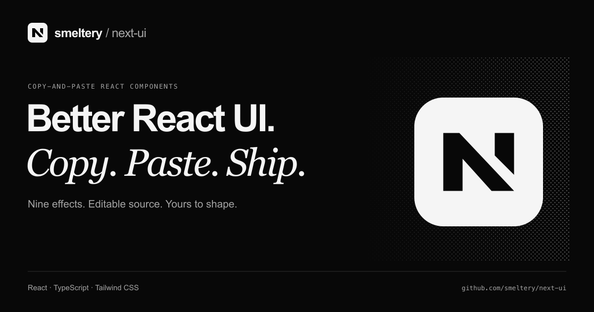

# Next UI

<p align="center"></p>

Small details. Better interfaces. Nine copy-paste React components with live previews, TypeScript source, and examples you can make your own.

[](https://github.com/smeltery/next-ui/actions/workflows/ci.yml)
[](https://github.com/smeltery/next-ui/releases)


[](.flox/env/manifest.toml)
[](LICENSE)



Explore light, borders, motion, and backgrounds. Copy only what you need; the source stays in your application. The showcase includes searchable documentation, live demos, and component and usage tabs.

## Run locally

```sh
flox activate
bun install --frozen-lockfile
bun run hooks:install
bun run dev
```

Open `http://localhost:3000`. Run `bun run check` for shared validation and `bun run verify` for a production build plus browser tests. Install Chromium once with `bunx playwright install chromium`.

[Explore the components](https://next-ui-orcin-chi.vercel.app/components) · [Component API](docs/api.md)

## Documentation

Start in [docs/](docs/index.md): [quick start](docs/quick-start.md), [components](docs/components.md), [customization](docs/customization.md), and [accessibility](docs/accessibility.md).

For the project itself: [development](docs/development.md), [architecture](docs/architecture.md), [contributing and CI](docs/contributing.md), and [releases](docs/releases.md).

Licensed under [PolyForm Shield 1.0.0](LICENSE).
