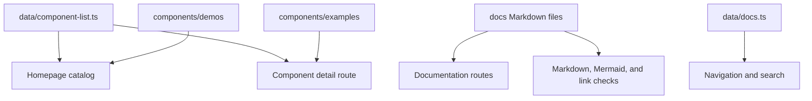

# Architecture

The showcase uses the Next.js App Router. Static content stays on the server; search, filters, demos, and copy controls run in client components.

## Content flow

## Main directories

| Path                   | Responsibility                                     |
| ---------------------- | -------------------------------------------------- |
| `app/`                 | Routes, metadata, and shared styles                |
| `components/examples/` | Copyable component implementations                 |
| `components/demos/`    | Live examples and copyable usage                   |
| `components/site/`     | Catalog, navigation, and search                    |
| `components/docs/`     | Documentation interactions                         |
| `data/`                | Component and documentation registries             |
| `docs/`                | User-facing Markdown, also rendered on the website |
| `scripts/`             | Shared validation and size budgets                 |

## Single documentation source

The docs route reads the Markdown files at build time. Relative Markdown links become website routes. Headings supply the page outline. Mermaid diagrams load only when a diagram enters the viewport; the source remains readable if rendering fails.

## Release boundary

CI validates the exact revision before a release workflow tags it. Releases are GitHub source releases, not npm publication or website deployment. See [releases](releases.md).
