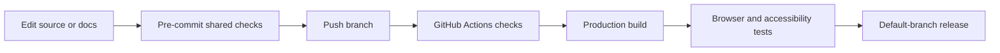

# Contributing & CI

Keep changes focused and source easy to read. Start with [local development](development.md), then run the same commands as CI.

## Shared checks

`bun run check` runs formatting, linting, TypeScript, Markdown validation, Mermaid parsing, local documentation links, source-size budgets, and focused regression tests. It does not rewrite files. Use `bun run format` to apply formatting before checking.

## Hooks

Run `bun run hooks:install` inside Flox. The pre-commit hook runs `bun run check`; the pre-push hook also builds the production site and runs the browser suite. Install Chromium once with `bunx playwright install chromium` before pushing.

Hooks are a convenience, not a substitute for required CI. They intentionally use the same scripts and frozen dependencies.

## Source budgets

Authored source, styles, scripts, workflows, and Markdown must stay below 400 lines per file. Directories may contain at most 25 directly contained checked files. Generated assets, dependency locks, and build output are excluded. Budget configuration lives in `scripts/budgets.json`.

Split by responsibility when a file grows. Do not minify code or add exceptions simply to make a check pass.

## Pull requests

Use conventional commits such as `feat:`, `fix:`, or `docs:`. Describe the behavior change and validation. Do not commit credentials, `.env` files, build output, or local browser evidence.

For a new component, add its source, demo, catalog entry, and documentation. Preserve existing component URLs. Test the actual preview and source tabs on desktop and mobile.

## Reporting problems

Open an [issue](https://github.com/smeltery/next-ui/issues) with the component, browser, viewport, reproduction steps, and expected behavior. Avoid sharing private application data.
