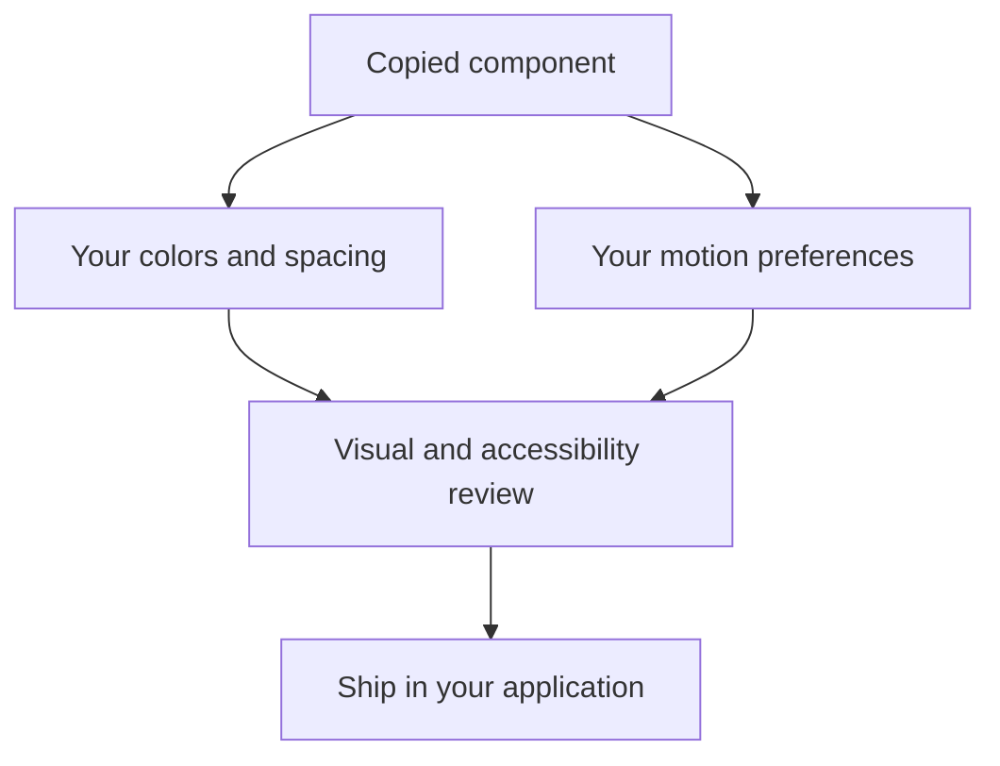

# Customization

Each component is a local source file in your application. Edit it directly instead of building a configuration layer around it.

## Colors and surfaces

Replace Tailwind color classes with your design tokens. Several demos use dark surfaces to make light effects visible; the surrounding website can remain light. Test text contrast independently from decorative highlights.

## Layout and sizing

Place the effect inside a positioned container with an explicit size. Use `overflow-hidden` only for intentional visual clipping, such as a meteor trail. Do not use it to hide layout overflow or focused controls.

## Animation

Keep durations long enough to feel calm. Use `matchMedia` to substitute a static state for pointer-driven transforms. CSS animations should include a `prefers-reduced-motion: reduce` override.

```css
@media (prefers-reduced-motion: reduce) {
  .decorative-effect {
    animation: none;
    transform: none;
  }
}
```

## Tailwind configuration

Merge the configuration from the component page into `theme.extend`. Keep your existing `content` globs and plugins. The example configuration targets Tailwind CSS 3 and is not a full replacement config.



## Troubleshooting

If an effect is missing, confirm the container has dimensions, Tailwind sees the source file, and all animation keys are present. If pointer effects are offset, inspect the component's positioned parent and pointer coordinates. If an import fails, align the `@/` alias with your source directory.
