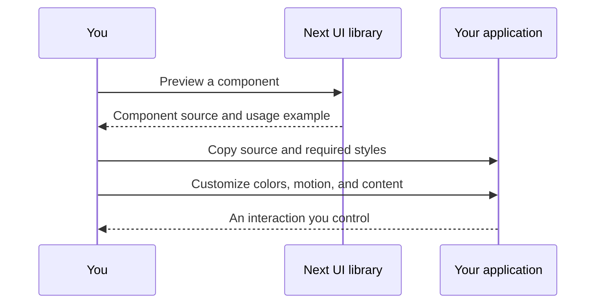

# Overview

Small details can change how an interface feels. Next UI is a collection of nine interactive React components, with live previews and source you can bring into your own project.

Start with the [component library](/components), the [quick start](quick-start.md), or the [component API](api.md).

## Build with code you can see

Choose a component, try its interaction, and copy its implementation. You keep the source in your application and adapt it to your design. There is no Next UI runtime package or hosted service to depend on.

The examples use React, TypeScript, Tailwind CSS 4. The showcase runs on Next.js. The components can also live in another React application with the same dependencies.

## How it works

## What you need

Use a React application with TypeScript and Tailwind CSS 4. Install only the dependencies imported by your chosen component. Components using hooks or browser interactions need a client boundary in the Next.js App Router.

Read the [quick start](quick-start.md) for setup, then browse the [component reference](components.md). Review [accessibility](accessibility.md) before shipping animation or pointer effects.

## What this library is not

Next UI focuses on decorative interaction patterns. It is not a complete form, navigation, or accessibility primitive library. Keep your existing semantic controls and use these effects as an enhancement.

Source is available under the repository's [PolyForm Shield license](../LICENSE). Review its terms before using or redistributing code.
