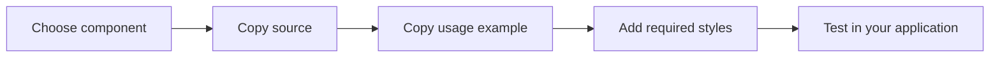

# Quick start

Bring a component into an existing React application. The examples target Tailwind CSS 3; Tailwind 4 projects need to translate the theme and animation configuration.

## Prepare your project

Start with React 18 or later, TypeScript, and a working Tailwind CSS 3 build. Install the utilities used by the examples:

```sh
bun add clsx tailwind-merge framer-motion
```

If your chosen component does not import Framer Motion, you can omit it. These are application dependencies; you do not install a `next-ui` package.

## Add the class utility

Create `lib/utils.ts` and ensure your `@/` alias resolves to your project root or source directory:

```ts
import { clsx, type ClassValue } from "clsx"
import { twMerge } from "tailwind-merge"

export function cn(...inputs: ClassValue[]) {
  return twMerge(clsx(inputs))
}
```

## Add the shared types

Several effects import `ExampleProps` or `SpotlightProps`. Create `types/type.ts`:

```ts
import type { ReactNode } from "react"

export interface ExampleProps {
  children?: ReactNode
  className?: string
}

export interface SpotlightProps extends ExampleProps {
  spotlightColor?: string
}
```

## Copy a component

Open [Spotlight](/spotlight), try the preview, then copy the **Component** source to `components/examples/spotlight.tsx`. The **Usage** tab provides the showcase example. It imports a local `CardItem` presentation helper; replace that helper with your own content, or copy it from the repository. Preserve the `"use client"` directive when the implementation uses React hooks.



A minimal Spotlight composition does not need the showcase helper:

```tsx
import { Spotlight } from "@/components/examples/spotlight"

export function FeatureCard() {
  return (
    <Spotlight
      className="h-52 w-64 bg-stone-950 p-6 text-white"
      spotlightColor="rgba(180, 210, 140, 0.18)"
    >
      <h2>A detail worth noticing</h2>
      <p>Your content stays readable without the effect.</p>
    </Spotlight>
  )
}
```

Some showcase usage files use the convenience aliases `@/examples`, `@/icons`, or `@/card-item`. Update them to match your own file locations. The library does not assume these aliases exist in your app.

## Include the styles

Ensure Tailwind scans your component directory. For Meteors, copy the animation and keyframes shown on the component page into `theme.extend` in your Tailwind configuration. Infinite Carousel includes its animation in the component’s scoped styles.

Do not replace your whole Tailwind configuration. Merge the supplied keys with your existing theme. The [customization guide](customization.md) explains the important boundaries.

## Verify the result

Check pointer interaction, keyboard access to any controls, small screens, and reduced motion. Decorative effects should not hide content or interfere with clicks. See the [accessibility checklist](accessibility.md) before shipping.
