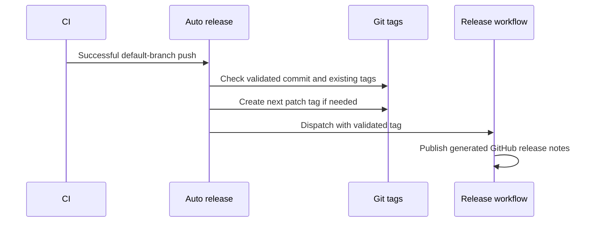

# Releases

Successful CI on the repository's default branch triggers automatic patch releases. Feature branches and pull requests never trigger a release.

## Workflow

## Version selection

The workflow selects the highest stable semantic version tag and increments its patch number. With no tags, it starts at `v0.1.0`. An existing release tag on the validated commit is reused. The workflow checks that the default branch still points at the validated commit before tagging.

## Retry and manual recovery

The release publication workflow is idempotent. Re-running auto-release dispatches publication even when the tag already exists, so a failed publication can recover. Maintainers can dispatch `release.yml` with an existing version tag.

## Scope

Releases contain GitHub's source archives and generated release notes. This repository is a private package and does not publish an npm library. Website hosting is configured independently.
